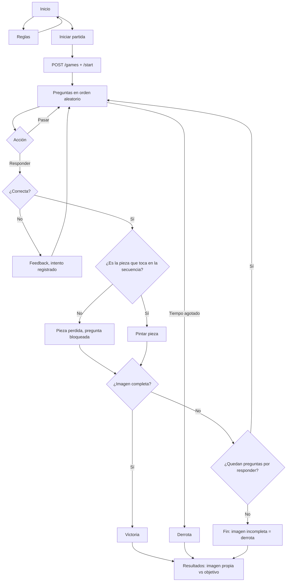

# Flujo del juego

## Estados de una pregunta

| Estado interno | Vista del jugador | Significado |
|---|---|---|
| `pending` | Pendiente | Sin intentos |
| `passed` | Pasada | El jugador la saltó; puede volver |
| `incorrect` | Incorrecta | Último intento falló; puede reintentar |
| `placed` | Resuelta | Correcta y su pieza se incorporó a la imagen |
| `locked` | Resuelta | Correcta, pero no era la que tocaba: la pieza se perdió y la pregunta ya no se puede repetir |

## Puntaje

`puntos = base del tipo × factor de dificultad × (+25 % si responde dentro del tiempo sugerido) × (−25 % si usó pista)`.
Con `SCORING_STRATEGY=linear`, cada error resta 20; con `forgiving`, no resta. El puntaje no determina la victoria.
